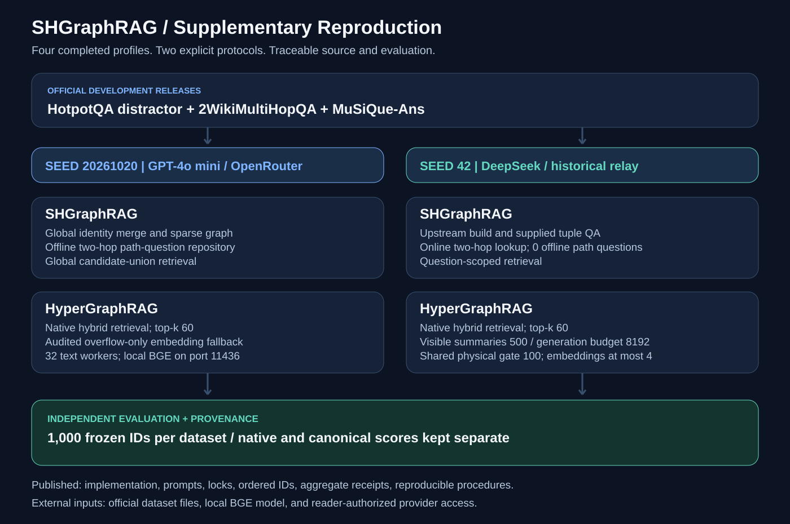

<div align="center">

<h1>SHGraphRAG</h1>

<p><strong>补充实验与完整复现</strong></p>

<p>SHGraphRAG · HyperGraphRAG &nbsp; | &nbsp; GPT‑4o mini · DeepSeek</p>

<p>
  <a href="LICENSE"></a>
  <a href="supplementary/docs/ENVIRONMENT.md"></a>
  <a href="#先确认实验口径"></a>
  <a href="supplementary/docs/DATA.md"></a>
  <a href="supplementary/docs/ENVIRONMENT.md#bgem3"></a>
</p>

<p>
  <a href="supplementary/docs/QUICKSTART.md"><strong>完整复现流程</strong></a> &nbsp;·&nbsp;
  <a href="supplementary/docs/CONFIGURATION.md">详细配置</a> &nbsp;·&nbsp;
  <a href="supplementary/docs/RESULTS.md">实验结果</a> &nbsp;·&nbsp;
  <a href="supplementary/docs/PROVENANCE.md">源码溯源</a>
</p>

<p><a href="README.md">English</a> &nbsp;|&nbsp; <strong>简体中文</strong></p>

</div>

---

本分支集中提供最近完成的 **SHGraphRAG / HyperGraphRAG × GPT‑4o mini / DeepSeek** 四组补充实验的完整执行代码、配置、提示词、依赖和复现流程。每组均包含 HotpotQA、2WikiMultiHopQA 和 MuSiQue-Ans 三个数据集，每个数据集评测 1,000 道开发集问题。



## 先确认实验口径

| 实验 | 抽样种子 | 主要实现与边界 |
| --- | ---: | --- |
| SHGraphRAG + GPT‑4o mini | 20261020 | 全局候选语料检索，实际构建离线两跳路径问题库 |
| HyperGraphRAG + GPT‑4o mini | 20261020 | 同样的问题 ID 和候选语料，原生 hybrid 检索 |
| SHGraphRAG + DeepSeek | 42 | 原始 tuple 抽取与问答链路，按问题限定检索，在线查两跳路径；**离线路径问题条目为 0** |
| HyperGraphRAG + DeepSeek | 42 | 与 DeepSeek SHGraphRAG 相同的问题及候选语料，但全局检索；包含经过记录的摘要长度适配 |

这些结果属于采用替代模型骨干的修订补充评测，不是原稿 Gemini 实验结果的重新运行。两套抽样和 SHGraphRAG 的实现不同，不能把跨模型结果的差异全部归因于模型能力。完整边界见 [LIMITATIONS.md](supplementary/docs/LIMITATIONS.md)。

## 本分支提供什么

- 四组实验实际使用的构图、实体合并、检索、问答、嵌入、评测、断点恢复及验证代码。
- 三个数据集分别冻结的 DeepSeek 实现，避免覆盖成功运行之间的版本差异。
- 原始提示词、依赖锁定、模型与嵌入配置、并发及重试设置。
- 六份有序问题 ID 清单、官方数据版本与哈希、从本地官方开发集重建全部输入的脚本。
- 脱敏后的配置、聚合指标和完成凭据，以及源码原始/发布 SHA‑256 与移植差异。
- 英文详细文档、中文导航、可点击的本地 SVG 徽章、两张配图和离线检查工具。

按本分支的用途，**不上传数据正文、标准答案、预测、图数据库、索引、向量、响应缓存、模型权重、虚拟环境或任何密钥**。问题 ID 属于小型复现元数据，不含问题与段落文本。

## 推荐阅读顺序

1. [QUICKSTART.md](supplementary/docs/QUICKSTART.md)：安装环境、离线准备、检查计划、执行、评分和验证。
2. [DATA.md](supplementary/docs/DATA.md)：准备官方文件，复现种子、ID 顺序、语料范围与候选段落数。
3. [CONFIGURATION.md](supplementary/docs/CONFIGURATION.md)：查阅模型、嵌入、提示词、阈值、并发、摘要和检索设置。
4. 对应实验指南：[SH / GPT‑4o mini](supplementary/docs/SHGRAPHRAG_GPT4OMINI.md)、[Hyper / GPT‑4o mini](supplementary/docs/HYPERGRAPHRAG_GPT4OMINI.md)、[SH / DeepSeek](supplementary/docs/SHGRAPHRAG_DEEPSEEK.md)、[Hyper / DeepSeek](supplementary/docs/HYPERGRAPHRAG_DEEPSEEK.md)。
5. [EVALUATION.md](supplementary/docs/EVALUATION.md) 与 [RESULTS.md](supplementary/docs/RESULTS.md)：区分单参考答案分数、原生别名分数、完整分母和空答案。
6. [PROVENANCE.md](supplementary/docs/PROVENANCE.md)：核对源码来源、成功运行标识、移植修改和本次发布验证范围。

```bash
git clone --single-branch --branch Sumpplementary https://github.com/Aimwo/SHGraphRAG.git
cd SHGraphRAG
python supplementary/tools/validate_release.py
python supplementary/tools/reproduce.py --profile sh-gpt4omini --dataset hotpotqa --data-root /absolute/path/to/prepared-data
```

默认只打印执行计划。读者真正发起模型调用时，需要自己的授权与凭据，并同时传入 `--execute --allow-model-api`。本次整理和发布只进行本地离线重建与测试，没有重新调用文本或嵌入模型来生成结果。

`Sumpplementary` 保留用户指定的分支拼写；原始根目录代码保留，本分支的补充实验入口位于 `supplementary/`。原始说明保存在 [UPSTREAM_README.md](supplementary/docs/UPSTREAM_README.md)，`main` 分支不承担本次补充发布。
