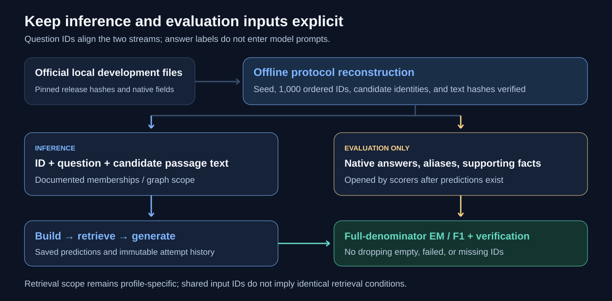

# Evaluation and completion verification

[Home](../../README.md) · [Results](RESULTS.md) · [Data protocol](DATA.md)

The unit of evaluation is a frozen question ID, with **1,000 IDs per dataset**. A complete controller run and a nonempty answer are different observations. Empty, failed, or missing answers cannot be removed to improve the denominator.



## Answer scores

EM checks normalized exact equality. Token F1 computes overlap precision and recall after normalization, using dataset-specific native behavior. All tables in this release use the 0–100 scale.

### GPT‑4o mini

The primary table uses a common **HotpotQA-style single-reference answer EM / token F1** on all three datasets. The separate native-alias table uses:

- HotpotQA: its original answer reference and boolean-aware behavior.
- 2Wiki: the canonical answer plus official answer-ID aliases and demonyms.
- MuSiQue: its answer plus native `answer_aliases`, with native normalization.

Do not mix `primary_em` with `native_alias_f1` in one reported pair. The source fields are explicitly named in the aggregate records.

### DeepSeek

The principal documented comparison uses **native answer protocols**. SHGraphRAG reports `answer_em_percent` / `answer_f1_percent`; HyperGraphRAG reports `native_alias_em` / `native_alias_f1`. Canonical single-reference fields, where available, remain separate.

For 2Wiki and MuSiQue, native alias-aware scores can exceed canonical scores without any prediction changing. This difference is an evaluation protocol effect.

## Supporting evidence

Some drivers also report passage recall at k, all-supports-at-k, or supporting-passage F1. These compare retrieved passage identities to supporting titles/paragraphs. They are not official sentence-level supporting-fact EM/F1 or official joint answer/support scores.

The supplied SHGraphRAG QA outputs chunk references, so a native sentence-level support score is not fabricated. Answer EM/F1 is the comparable reported target.

## Annotation boundary

Inference files contain `id` and `question`, plus candidate passage text and the documented construction/retrieval memberships. They exclude answer and supporting-fact labels. Gold is opened by evaluation code after predictions exist.

Matching question IDs and candidate corpora does not remove the retrieval-scope distinction in the DeepSeek pair. SHGraphRAG keeps question-specific graph namespaces and filters candidates; HyperGraphRAG searches the pooled corpus.

## Completion criteria

A reader-generated run should preserve enough evidence to check:

1. Source/configuration identity and dependency locks.
2. Official input hashes, the complete frozen ID order, and candidate corpus membership.
3. Construction completion, graph counts, index file hashes, and index readiness.
4. Exactly one accepted latest prediction per frozen ID, with all attempt history retained.
5. Provider request/response identity, model allowlist, finish reason, physical usage, and cache origin.
6. Native/canonical evaluation over the same complete 1,000-ID denominator.
7. Dataset-specific implementation limits, including path-question count.

Each method guide names the verifier. Most drivers invoke their verifier automatically at completion; the wrapper also exposes an offline `verify` phase.

## Historical receipts versus new checks

`records/` contains data-free historical receipts and aggregates. Most JSON files wrap the original scientific content in:

```json
{
  "record_kind": "historical_metadata_not_a_new_run",
  "source_file": "original relative evidence location",
  "original_file_sha256": "hash of the original unsanitized evidence file",
  "content": {}
}
```

Publication strips per-question/per-sample data and private operator/credential references. The original hash identifies the historical source; it is not the checksum of the sanitized exported JSON. Published-file checksums live in `provenance/source_manifest.json`.

The acceptance receipts describe completed historical experiments. This publication's [release validation](../provenance/release_validation.json) covers source/document checks, official-input reconstruction, all profile preparation handoffs, and mocked regression tests. **No new hosted-model or BGE inference was performed for publication.** Data, predictions, and raw response artifacts are intentionally absent, so readers cannot recompute the historical scores from this repository alone; they can execute the supplied pipelines with independently obtained inputs and their own model access.
