# SHGraphRAG with GPT‑4o mini

[Home](../../README.md) · [Quick start](QUICKSTART.md) · [Configuration](CONFIGURATION.md)

This implementation is the completed `source_alias_merge_global_graph_v2` campaign. It performs global alias reconciliation, sparse graph construction, offline path-question generation, and global retrieval over each frozen sample's pooled candidate corpus.

## Source and accepted run

- Implementation: [`code/shgraphrag_gpt4omini/`](../code/shgraphrag_gpt4omini/).
- Accepted campaign: `full1000_4omini_v2_20261021`, completed on October 22, 2026.
- Per-dataset evidence: [`records/shgraphrag_gpt4omini/`](../records/shgraphrag_gpt4omini/).
- Protocol: seed 20261020; three datasets × 1,000 development questions.
- All 15 frozen core module hashes matched the accepted campaign before publication portability changes.

## 1. Install and reconstruct inputs

Use Python 3.11 and [`requirements.lock.txt`](../code/shgraphrag_gpt4omini/reproduction/requirements.lock.txt). Follow [DATA.md](DATA.md) to produce a separate prepared-data root.

```powershell
$python = (Resolve-Path supplementary/.venv-sh-gpt/Scripts/python.exe).Path
$dataRoot = 'D:/research/shgraphrag-prepared'
& $python supplementary/tools/reproduce.py --profile sh-gpt4omini --dataset hotpotqa --data-root $dataRoot --run-name reproduce_01 --phase prepare --execute
```

Preparation writes label-free `questions.json`, pooled `corpus.jsonl`, construction group memberships, and separate evaluation gold under the selected run. It validates source file hashes before handing inputs to inference.

## 2. Prepare BGE‑M3

Use local Ollama at `http://127.0.0.1:11434`, the digest and dimensions in [ENVIRONMENT.md](ENVIRONMENT.md), and 32-item batches with `truncate=false`. No Neo4j service is required.

## 3. Execute

Provide your own authorized `OPENROUTER_API_KEY` in the process environment. The model is pinned to `openai/gpt-4o-mini`, temperature 0, Chat Completions. Optional `OPENROUTER_PROXY` affects text requests only.

```powershell
& $python supplementary/tools/reproduce.py --profile sh-gpt4omini --dataset hotpotqa --data-root $dataRoot --run-name reproduce_01 --phase run --execute --allow-model-api
```

Repeat for `2wiki` and `musique`, retaining the same run name and the documented sample protocol. Default workers are 64. To reproduce an explicitly lower scheduling setting, pass `--workers` consistently to preparation and execution and report the change.

The runner's stages are:

```mermaid
flowchart LR
    A["Frozen queries and candidate union"] --> B["JSON extraction"]
    B --> C["Alias confirmation and global identity merge"]
    C --> D["Bridge-based sparse graph"]
    D --> E["All simple two-edge paths"]
    E --> F["Two generated questions per path"]
    F --> G["BGE path and entity indexes"]
    G --> H["Decomposition and global retrieval"]
    H --> I["Short-answer generation"]
    I --> J["Separate native gold evaluation"]
```



The graph build retains entity, relation, passage, and path provenance. The path repository is uncapped; no sampled subset substitutes for the full enumeration. Query-time path search uses the offline question index and selects distinct paths.

## 4. Resume or run a stage

The wrapper resumes a matching saved contract. For targeted recovery, the implementation's native CLI is available from its own source directory:

```powershell
Push-Location supplementary/code/shgraphrag_gpt4omini
& $python -m reproduction.runner --dataset hotpotqa --source $dataRoot --output reproduction/runs/reproduce_01/hotpotqa --limit 1000 --workers 64 --stage index
Pop-Location
```

Stages are `prepare`, `extract`, `graph`, `paths`, `index`, `predict`, `evaluate`, and `all`. Model-bearing stages require explicit `SHGRAPHRAG_ALLOW_MODEL_API=1`; the public wrapper sets this only for authorized `run`. A targeted stage can contain text or embedding work, so inspect the stage before enabling it.

Do not share an arbitrary response cache from another provider, model, schema, or prompt version. Preserve all previous invocation logs when resuming. A resumed invocation wall time is not a cold construction time.

## 5. Evaluate and verify

```powershell
& $python supplementary/tools/reproduce.py --profile sh-gpt4omini --dataset hotpotqa --data-root $dataRoot --run-name reproduce_01 --phase evaluate --execute
& $python supplementary/tools/reproduce.py --profile sh-gpt4omini --dataset hotpotqa --data-root $dataRoot --run-name reproduce_01 --phase verify --execute
```

The verifier checks source preservation, data hash alignment, exactly 1,000 unique query IDs, extraction coverage, alias resolution provenance, uncapped path coverage, index provenance, response artifacts, retrieval choices, prediction coverage, and evaluation artifacts. It requires the reader's actual run outputs; historical JSON aggregates are not substitutes.

## Expected artifact families

Under `reproduction/runs/<run-name>/<dataset>/`:

| Artifact | Purpose |
| --- | --- |
| `config.json`, `code_manifest.json` | Effective settings and source identity |
| `inputs/`, `evaluation/` | Label-free inference handoff and separate scoring |
| `extractions/`, `entity_resolution/` | Raw extraction and identity reconciliation |
| `graph.json` | Global sparse graph |
| `path_repository.jsonl`, `path_repository_manifest.json` | All paths and generated path questions |
| Index arrays and associated manifests | Exact cosine search inputs and hashes |
| `predictions/`, request/timing/progress logs | QA checkpoints and per-attempt evidence |
| `verification.json` | Run-level completion and provenance checks |

Accepted path totals:

| Dataset | Two-edge paths | Generated questions |
| --- | ---: | ---: |
| HotpotQA | 532,333 | 1,064,666 |
| 2Wiki | 180,222 | 360,444 |
| MuSiQue | 1,249,734 | 2,499,468 |

These counts describe the completed historical graph extractions. Hosted-model nondeterminism can change newly generated graphs and path totals even with the same sampling seed. Such a fresh run should preserve and report its own measured counts.
